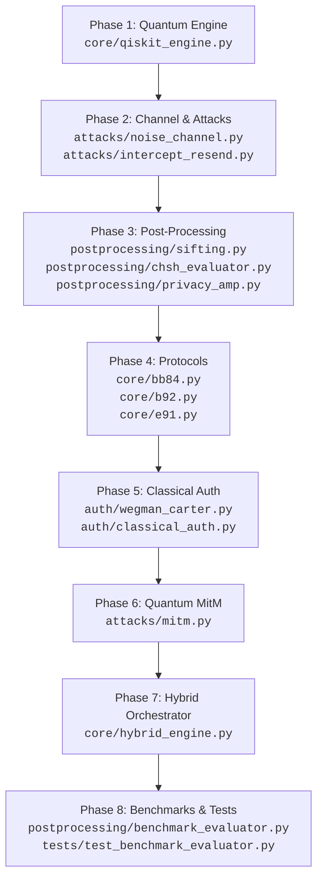

# 🧭 Codebase Study Roadmap: Quantum Authentication & QKD Suite

A clean, step-by-step reading curriculum structured from low-level quantum simulation up to protocol orchestration, attack analysis, and benchmarks.

---

## 📑 Master Reading Checklist

| Step | Module / File | Target Symbol | Lines | Key Focus |
| :---: | :--- | :--- | :---: | :--- |
| **01** | [`core/qiskit_engine.py`](./core/qiskit_engine.py) | `QiskitEngine` | [L10–L45](./core/qiskit_engine.py#L10-L45) | Aer MPS backend & register decoding |
| **02** | [`attacks/noise_channel.py`](./attacks/noise_channel.py) | `QuantumNoiseChannel` | [L9–L41](./attacks/noise_channel.py#L9-L41) | Photon loss, bit-flips, depolarizing noise |
| **03** | [`attacks/intercept_resend.py`](./attacks/intercept_resend.py) | `InterceptResendAttack` | [L21–L62](./attacks/intercept_resend.py#L21-L62) | Eve measuring and resending collapsed qubits |
| **04** | [`postprocessing/sifting.py`](./postprocessing/sifting.py) | `sift_bb84`, `sift_b92`, `sift_e91` | [L22–L140](./postprocessing/sifting.py#L22-L140) | Basis reconciliation and QBER calculation |
| **05** | [`postprocessing/chsh_evaluator.py`](./postprocessing/chsh_evaluator.py) | `CHSHEvaluator` | [L21–L125](./postprocessing/chsh_evaluator.py#L21-L125) | Bell inequality \|S\| correlation parameter |
| **06** | [`postprocessing/privacy_amp.py`](./postprocessing/privacy_amp.py) | `PrivacyAmplifier` | [L20–L80](./postprocessing/privacy_amp.py#L20-L80) | Shannon privacy amplification & distillation |
| **07** | [`core/bb84.py`](./core/bb84.py) | `BB84Protocol.run` | [L31–L174](./core/bb84.py#L31-L174) | 4-state prepare-and-measure protocol |
| **08** | [`core/b92.py`](./core/b92.py) | `B92Protocol.run` | [L33–L186](./core/b92.py#L33-L186) | 2-state USD conclusive detection protocol |
| **09** | [`core/e91.py`](./core/e91.py) | `E91Protocol.run` | [L34–L230](./core/e91.py#L34-L230) | Entanglement EPR Bell-state protocol |
| **10** | [`auth/wegman_carter.py`](./auth/wegman_carter.py) | `WegmanCarterAuth` | [L9–L44](./auth/wegman_carter.py#L9-L44) | Universal hashing over Mersenne prime $2^{127}-1$ |
| **11** | [`auth/classical_auth.py`](./auth/classical_auth.py) | `ClassicalAuthenticator` | [L12–L40](./auth/classical_auth.py#L12-L40) | Channel tag generation & HMAC fallback |
| **12** | [`attacks/mitm.py`](./attacks/mitm.py) | `MitMAttack.execute_attack` | [L159–L335](./attacks/mitm.py#L159-L335) | Dual-leg interception & auth tag verification |
| **13** | [`core/hybrid_engine.py`](./core/hybrid_engine.py) | `HybridAuthEngine` | [L26–L130](./core/hybrid_engine.py#L26-L130) | Adaptive protocol choice & key recycling |
| **14** | [`postprocessing/benchmark_evaluator.py`](./postprocessing/benchmark_evaluator.py) | `Benchmark Evaluator` | [L24–L287](./postprocessing/benchmark_evaluator.py#L24-L287) | Devetak-Winter key rate, ROC hypothesis tests |
| **15** | [`tests/test_benchmark_evaluator.py`](./tests/test_benchmark_evaluator.py) | `TestBenchmarkEvaluator` | [L17–L84](./tests/test_benchmark_evaluator.py#L17-L84) | Unit test assertions for all math functions |

---

## 🔍 Detailed Reading Steps

### 1. Quantum Backend Engine
Start here to understand how circuits are executed and measurement registers are decoded.

- [ ] **[`core/qiskit_engine.py`](./core/qiskit_engine.py)**
  - [`QiskitEngine.__init__`](./core/qiskit_engine.py#L13-L15) — Configures `AerSimulator` with Matrix Product State (`method="matrix_product_state"`).
  - [`run_circuit`](./core/qiskit_engine.py#L17-L20) — Executes quantum circuits with specified shot counts.
  - [`sample_registers`](./core/qiskit_engine.py#L22-L40) — Decodes separate classical bit registers (Alice, Bob, Eve).

---

### 2. Physical Channel & Attack Injections
Understand how physical channel noise and eavesdropping disturb quantum states in flight.

- [ ] **[`attacks/noise_channel.py`](./attacks/noise_channel.py)**
  - [`QuantumNoiseChannel`](./attacks/noise_channel.py#L9-L41) — Models optical fiber loss, random Pauli bit-flips ($X$), and depolarizing noise ($X, Y, Z$).
- [ ] **[`attacks/intercept_resend.py`](./attacks/intercept_resend.py)**
  - [`InterceptResendAttack.apply_to_qubit`](./attacks/intercept_resend.py#L31-L62) — Eve measures in random basis ($Z$ or $X$) and resends collapsed state to Bob.

---

### 3. Post-Processing & Cryptographic Distillation
Read how raw measurement outcomes are filtered, tested for errors, and distilled into secure keys.

- [ ] **[`postprocessing/sifting.py`](./postprocessing/sifting.py)**
  - [`sift_bb84`](./postprocessing/sifting.py#L22-L60) — Retains matching basis indices ($Z/X$) and calculates QBER against the 11% threshold.
  - [`sift_b92`](./postprocessing/sifting.py#L61-L101) — Retains only conclusive detection events against the 4.8% threshold.
  - [`sift_e91`](./postprocessing/sifting.py#L102-L140) — Isolates rectilinear key-generation coincidences ($a_2, b_2$).
- [ ] **[`postprocessing/chsh_evaluator.py`](./postprocessing/chsh_evaluator.py)**
  - [`calculate_correlation`](./postprocessing/chsh_evaluator.py#L27-L44) — Computes correlation coefficient $E(a, b) = \frac{N_{00} + N_{11} - N_{01} - N_{10}}{N_{total}}$.
  - [`evaluate_e91_chsh`](./postprocessing/chsh_evaluator.py#L46-L125) — Computes Bell parameter $S$. Compares against classical bound ($2.0$) and Cirel'son bound ($2\sqrt{2} \approx 2.828$).
- [ ] **[`postprocessing/privacy_amp.py`](./postprocessing/privacy_amp.py)**
  - [`PrivacyAmplifier.distill_secret_key`](./postprocessing/privacy_amp.py#L24-L80) — Error reconciliation and Shannon entropy compression ($r = 1 - 2h(QBER)$).

---

### 4. Core QKD Protocol Implementations
Trace the quantum state preparation, transmission, measurement, and post-processing in each protocol.

- [ ] **[`core/bb84.py`](./core/bb84.py)**
  - [`BB84Result`](./core/bb84.py#L15-L30) — Dataclass storing bits, bases, circuit, and sifting results.
  - [`BB84Protocol.run`](./core/bb84.py#L38-L174) — End-to-end 4-state protocol lifecycle.
- [ ] **[`core/b92.py`](./core/b92.py)**
  - [`B92Result`](./core/b92.py#L15-L32) — Dataclass tracking $|0\rangle, |+\rangle$ transmissions and conclusive flags.
  - [`B92Protocol.run`](./core/b92.py#L40-L186) — Unambiguous State Discrimination (USD) simulation.
- [ ] **[`core/e91.py`](./core/e91.py)**
  - [`E91Protocol._rotate_measurement`](./core/e91.py#L47-L51) — Measurement basis rotation along the Y-axis.
  - [`E91Protocol.run`](./core/e91.py#L52-L230) — EPR Bell pair generation ($|\Phi^+\rangle$) and dual key/CHSH sifting.

---

### 5. Classical Authentication Layer
Understand how the public discussion channel is guarded against spoofing.

- [ ] **[`auth/wegman_carter.py`](./auth/wegman_carter.py)**
  - [`derive_subkeys`](./auth/wegman_carter.py#L19-L25) — Derives hash subkeys $(a, b)$ from the pre-shared secret.
  - [`compute_tag`](./auth/wegman_carter.py#L27-L37) — Evaluates $Tag = (a \cdot m + b) \pmod{2^{127}-1}$.
  - [`verify`](./auth/wegman_carter.py#L39-L44) — Constant-time verification of authentication tags.
- [ ] **[`auth/classical_auth.py`](./auth/classical_auth.py)**
  - [`ClassicalAuthenticator`](./auth/classical_auth.py#L12-L40) — Universal wrapper switching between Wegman-Carter and HMAC-SHA256.

---

### 6. Man-in-the-Middle (MitM) Attack Simulation
Trace how Eve physically intercepts both channels and how authentication blocks forgery.

- [ ] **[`attacks/mitm.py`](./attacks/mitm.py)**
  - [`_xor_encrypt` & `_xor_decrypt`](./attacks/mitm.py#L67-L101) — Stream cipher / OTP encryption with derived keys.
  - [`_run_bb84_key_exchange`](./attacks/mitm.py#L103-L155) — Simulates independent key exchange legs ($A \leftrightarrow E$ and $E \leftrightarrow B$).
  - [`MitMAttack.execute_attack`](./attacks/mitm.py#L184-L335) — Intercepts message, verifies tag, and demonstrates why unauthenticated QKD fails while authenticated QKD aborts.

---

### 7. Hybrid Authentication & Adaptive Engine
Examine how protocol selection dynamically responds to channel conditions and recycles distilled keys.

- [ ] **[`core/hybrid_engine.py`](./core/hybrid_engine.py)**
  - [`recommend_protocol`](./core/hybrid_engine.py#L36-L53) — Adapts between BB84, B92, or E91 based on noise and hardware constraints.
  - [`run_hybrid_session`](./core/hybrid_engine.py#L54-L130) — Orchestrates key generation, recycling, and active MitM defense.

---

### 8. Analytical Benchmarking & Unit Tests
Inspect closed-form theoretical curves, asymptotic key rate formulas, and automated unit assertions.

- [ ] **[`postprocessing/benchmark_evaluator.py`](./postprocessing/benchmark_evaluator.py)**
  - [`binary_entropy`](./postprocessing/benchmark_evaluator.py#L24-L29) — Binary Shannon entropy $h(p)$.
  - [`secret_key_rate`](./postprocessing/benchmark_evaluator.py#L31-L42) — Devetak-Winter asymptotic rate $R = Y \cdot [1 - (1+f_{ec})h(e)]$.
  - [`calculate_attack_detection_and_false_alarm`](./postprocessing/benchmark_evaluator.py#L44-L70) — Binomial hypothesis testing ($H_0$ vs $H_1$).
  - [`get_analytical_curves`](./postprocessing/benchmark_evaluator.py#L72-L177) — Parametric dataframes for noise, attacks, and ROC curves.
- [ ] **[`tests/test_benchmark_evaluator.py`](./tests/test_benchmark_evaluator.py)**
  - [`TestBenchmarkEvaluator`](./tests/test_benchmark_evaluator.py#L17-L84) — Complete unit test suite verifying all mathematical models.
